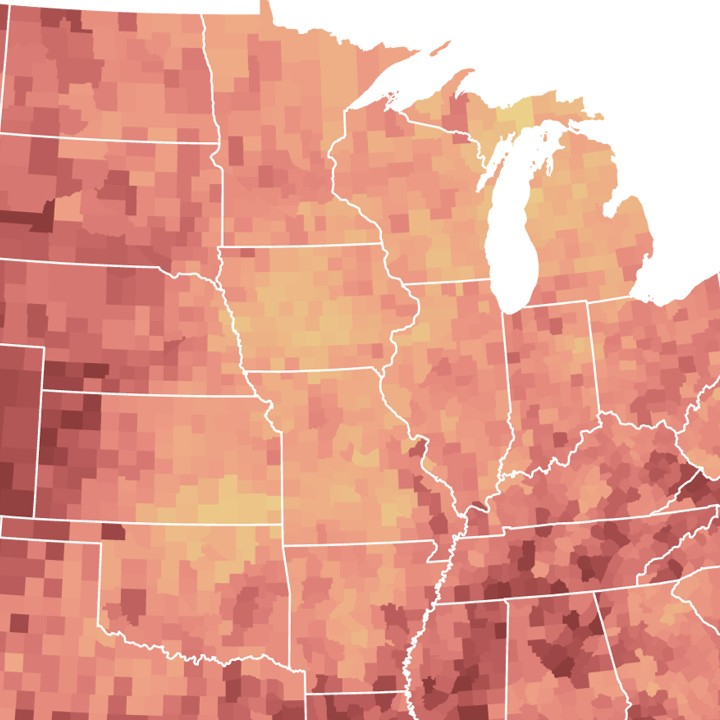
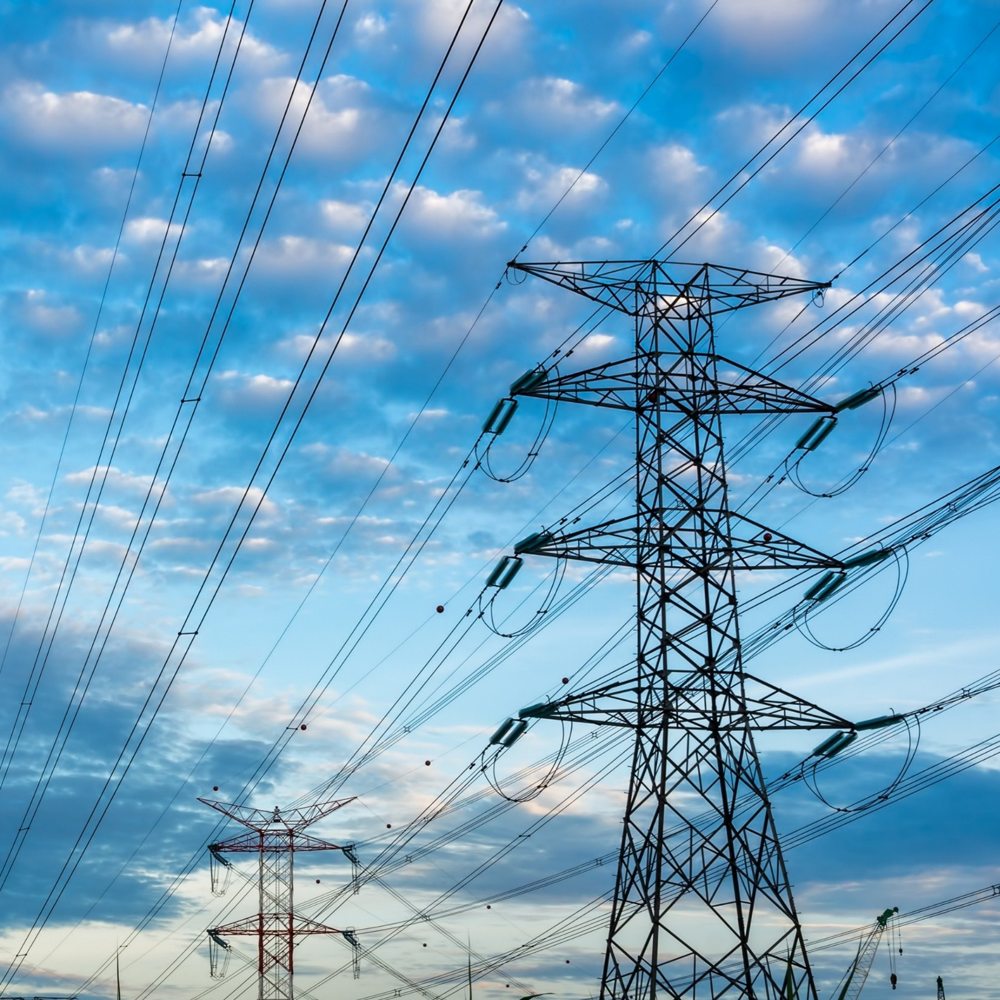
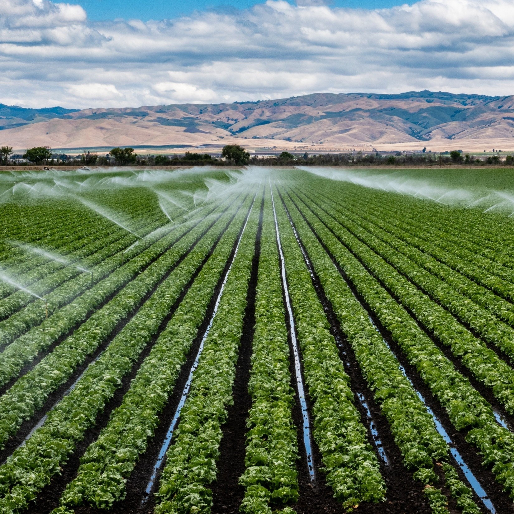

I am an economist and fellow at <a href="https://www.rff.org/people/kristen-mccormack/" target="_blank">Resources for the Future</a>. My research focuses on the distributional effects of climate change (especially <a href="https://www.rff.org/publications/explainers/extreme-heat-in-the-united-states/" target="_blank">extreme heat</a>) and the design of energy and environmental policy under regulatory and market uncertainty. Prior to joining RFF, I was a financial economist at the U.S. Department of the Treasury's Office of Tax Analysis.

I hold a Ph.D. in Public Policy (Economics Track) from Harvard University and graduated *summa cum laude* from Pomona College with a B.A. in Economics. Explore my recent work by topic below or see my <a href="/research/">research page</a> for all published and working papers, reports, and other commentary.

<section class="focus" aria-labelledby="focus-heading">
<h2 class="focus-heading" id="focus-heading">Recent areas of focus</h2>

  <button class="focus-tile" aria-expanded="true" aria-controls="focus-heat">
    
    Extreme heat impacts and adaptation
  </button>
  <button class="focus-tile" aria-expanded="false" aria-controls="focus-air">
    
    Air pollution and greenhouse gas regulation
  </button>
  <button class="focus-tile" aria-expanded="false" aria-controls="focus-biofuels">
    
    Biofuels policy design
  </button>

  

    <ul>
      <li><a href="/files/mccormack_jmp.pdf" target="_blank" rel="noopener">Education under extremes</a> (paper)</li>
      <li><a href="https://www.resources.org/resources-radio/resources-radio-sweating-over-student-behavior-in-hot-schools-with-kristen-mccormack/" target="_blank" rel="noopener">Sweating over student behavior in hot schools</a> (podcast)</li>
      <li><a href="https://www.rff.org/publications/explainers/extreme-heat-in-the-united-states/" target="_blank" rel="noopener">Extreme heat in the United States</a> (explainer)</li>
    </ul>
  

  

    <ul>
      <li><a href="https://www.rff.org/topics/federal-climate-policy/losing-the-endangerment-finding-what-are-the-costs-and-benefits-of-deregulation/" target="_blank" rel="noopener">Losing the Endangerment Finding</a> (blog series; report forthcoming)</li>
      <li><a href="https://www.resources.org/common-resources/ifthen-the-uncertain-future-of-coal-and-what-it-means-for-climate-air-quality-and-the-energy-economy/" target="_blank" rel="noopener">The uncertain future of coal</a> (blog)</li>
      <li><a href="https://onlinelibrary.wiley.com/doi/10.1111/1756-2171.12294" target="_blank" rel="noopener">Energy markets, environmental regulation, and coal plant profits</a> (paper)</li>
    </ul>
  

  

    <ul>
      <li><a href="https://www.journals.uchicago.edu/doi/10.1086/744324" target="_blank" rel="noopener">Policy interactions and the cost of decarbonizing aviation</a> (paper)</li>
      <li><a href="https://www.resources.org/common-resources/high-costs-and-few-benefits-from-californias-proposed-sustainable-aviation-fuel-tax-credit/" target="_blank" rel="noopener">California’s proposed sustainable aviation fuel tax credit</a> (blog)</li>
      <li><a href="https://onlinelibrary.wiley.com/doi/full/10.1002/ajae.12014" target="_blank" rel="noopener">The price of biodiesel RINs and economic fundamentals</a> (paper)</li>
    </ul>
  

</section>

